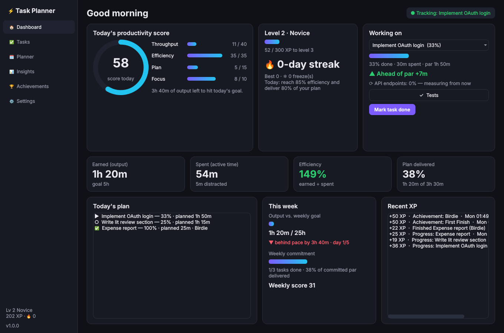

# Task Planner ⚡

A gamified Windows productivity app that tracks **finished work per hour** instead of hours logged.

Every task gets a predicted **par time**. Progress is measured from what the work produces: commits, words written, output files, or checklist ticks. Your score rewards finishing as much as possible in as little time as possible.



## How it works

| Concept | What it means |
|---|---|
| **Par** | Predicted focused time for a task. It comes from your guess or Claude's breakdown, calibrated on your own history. The model uses your *faster* runs (40th percentile), so par tightens as you improve and being slow doesn't loosen it. Par locks once you start; you can re-estimate, but each re-estimate cuts the finish bonus by 20%. |
| **Milestones** | Each task is split into milestones. Each one finishes from real evidence: **git** (new commits, lines changed including uncommitted work, or a commit message), **document** (new words in .docx/.pptx/.odt/.md/.txt/.tex/.html), **folder** (new output files matching a pattern), or a **checklist** tick. Milestones that read the same source run one after another. |
| **Earned time** | A finished milestone earns its share of par. A 2 h task done in 4 h earns 2 h. |
| **Spent time** | Active, non-idle time on the task's windows plus time in distracting apps. The app samples the foreground window and idle time every 5 s, and stops counting on lock or idle (the idle tail is trimmed back). |
| **Efficiency** | earned ÷ spent |
| **Daily score (0–100)** | Throughput 40 (earned vs. 5 h goal) · Efficiency 35 (full marks at 125%) · Plan 15 (share of plan delivered × plan density) · Focus 10 (distractions and context switches). |
| **Planner** | Packs par times into your working hours and shows plan density against what you've actually delivered before. Only output earned *after* you commit the plan counts as delivered. |
| **Weekly targets** | A weekly output goal (default 25 h of par, over 5 working days) plus a weekly commitment: the tasks you promise to finish this week (**Planner → This week**). The dashboard shows weekly pace (ahead or behind where you should be by today). The daily auto-fill puts ★ weekly commitments first. When the week closes it gets a score (Output 50 · Delivery 35 · Efficiency 15) and XP. Delivering 90%+ of the commitment adds a bonus of ¼ XP per committed minute. Only output earned after committing counts. |
| **Gamification** | XP for earned minutes. Finish bonuses: Eagle (≤60% of par) ×2, Birdie (≤85%) ×1.5, Par ×1.25. Plan Bonus for delivering a dense plan, levels and titles, streaks with freezes, 28 achievements, a live ahead/behind-par meter, and nudges when you drift into distracting apps. |

### Time tracking → tasks
Each window sample is assigned like this:

1. **Excluded apps** are never recorded.
2. **Idle or locked** time is not counted.
3. **Task match:** the window title contains a task keyword, or the name of its linked repo, document or folder. Optionally the match is limited to the apps you list for that task.
4. **Distracting:** distracting apps or title keywords (YouTube, Reddit, …). An explicit task match wins, e.g. a "YouTube Studio" task.
5. **Pinned task:** if you've pinned a task ("Working on…"), other non-distracting time is credited to it.

Time that matches no task shows up in **Insights → Unassigned time**, where you can assign it in one click.

Everything stays in a local SQLite file in `%APPDATA%\TaskPlanner\`.

## AI breakdown with your Claude subscription
**✨ Break down with Claude** runs your local Claude Code CLI in headless mode:

```bash
claude -p --output-format json --json-schema <schema> --tools "" --no-session-persistence
```

It uses whatever account `claude` is logged into, so it runs on your Claude subscription and needs no API key. Tools are disabled and the command runs in an empty temporary folder, so Claude can't read or change your files. It returns milestones, estimates, the best evidence source for each milestone, and window keywords.

Setup:
1. Install [Claude Code](https://claude.com/claude-code).
2. Run `claude` once in a terminal to sign in.
3. Check **Settings → AI breakdown → Detect CLI**.

If you installed it through npm (`claude.cmd`), the app calls `node cli.js` directly to avoid cmd.exe quoting problems.

## Install (Windows)
Download `TaskPlannerSetup-x.y.z.exe` from the **Actions** artifacts or a **Release**. It installs per user and needs no admin rights. The installer can also start the app when you sign in, which is recommended so tracking is always on. The app runs in the system tray, and closing the window keeps it tracking.

### Build it yourself
```powershell
./build_windows.ps1        # venv + tests + PyInstaller (+ Inno Setup installer if installed)
```

### Run from source
```bash
pip install -r requirements-dev.txt
python -m taskplanner            # --minimized starts in the tray
pytest -q
```

## Project layout
```
taskplanner/
  core/       models, db (SQLite + migrations), estimator (par), scoring, gamification, planner, engine
  tracking/   win32 (ctypes: foreground window, idle, lock), sampler, matcher, recorder
  progress/   git / document / folder progress detectors
  ai/         Claude Code CLI breakdown
  ui/         PySide6 views, tray, theme, controller (timers + background workers)
packaging/    PyInstaller spec, Inno Setup script
tests/        unit tests + offscreen UI smoke test
```
